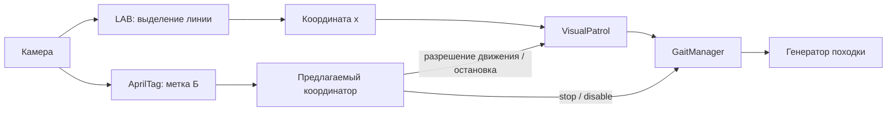

# AiNex Raspberry Pi 5: движение по линии А→Б и план испытаний

Дата исследования: 14 октября 2026 года.

## 1. Вывод и границы этапа

**Штатный программный модуль есть: `ainex_example/visual_patrol`.** Он использует камеру, распознавание цвета в OpenCV и генератор двуногой походки. Для исходного сценария отдельный ИК-датчик линии не требуется. Производитель описывает эту функцию в [официальном уроке §7.1.2](https://github.com/Hiwonder-docs/AiNex/blob/f737cf444c1dd03e8d1d1e346327516871b9d651/source/docs/7.ROS%20Robot%20Integrated%20Development%20Lesson.md#712-intelligent-line-following).

Согласованные условия первого этапа: ровная поверхность, контрастная линия без развилок, отдельная AprilTag-метка в точке Б. Начальный стенд — прямая линия; плавные изгибы можно проверить дополнительно, если они появятся на реальном маршруте. Возврат Б→А и движение с грузом относятся к следующему этапу.

Штатный пример решает удержание линии. Для завершённого А→Б нужны дополнительно: распознавание финишной зоны, остановка, контроль потери линии/камеры и единый владелец команд движения. Это предлагаемые доработки, а не уже имеющиеся возможности демонстрации.

Исследованы официальный код и документация, а также локальные `tag_grab.py` и `scrip.py`. Подключения к роботу не было; физические испытания и проверка установленного образа ещё не выполнены. Исходные скрипты проекта не изменялись.

## 2. Найденный готовый код

Официальный репозиторий: [Hiwonder/ainex](https://github.com/Hiwonder/ainex). Исследованный commit: `e8fe2a816797cf83054135160df5a82ec3596a69`. Документация: [Hiwonder-docs/AiNex](https://github.com/Hiwonder-docs/AiNex), commit `f737cf444c1dd03e8d1d1e346327516871b9d651`. Ссылки закреплены на этих версиях; образ конкретного робота может отличаться.

| Файл | Назначение |
|---|---|
| [visual_patrol_node.launch](https://github.com/Hiwonder/ainex/blob/e8fe2a816797cf83054135160df5a82ec3596a69/src/ainex_example/scripts/visual_patrol/visual_patrol_node.launch) | Запуск зрения, базового контроллера и поведения |
| [visual_patrol_node.py](https://github.com/Hiwonder/ainex/blob/e8fe2a816797cf83054135160df5a82ec3596a69/src/ainex_example/scripts/visual_patrol/visual_patrol_node.py) | Параметры линии, приём результатов и вызов управления |
| [color_detection.py](https://github.com/Hiwonder/ainex/blob/e8fe2a816797cf83054135160df5a82ec3596a69/src/ainex_example/scripts/color_detection/color_detection.py) | Выделение линии в изображении |
| [visual_patrol.py](https://github.com/Hiwonder/ainex/blob/e8fe2a816797cf83054135160df5a82ec3596a69/src/ainex_example/src/ainex_example/visual_patrol.py) | Преобразование смещения линии в параметры шага |
| [gait_manager.py](https://github.com/Hiwonder/ainex/blob/e8fe2a816797cf83054135160df5a82ec3596a69/src/ainex_driver/ainex_kinematics/src/ainex_kinematics/gait_manager.py) | Интерфейс к генератору походки |
| [visual_patrol_pick_up_node.py](https://github.com/Hiwonder/ainex/blob/e8fe2a816797cf83054135160df5a82ec3596a69/src/ainex_example/scripts/visual_patrol_pick_up/visual_patrol_pick_up_node.py) | Пример состояний «линия → цветной блок → захват → линия → размещение» |
| [autonomous_transport_node.py](https://github.com/Hiwonder/ainex/blob/e8fe2a816797cf83054135160df5a82ec3596a69/src/ainex_example/scripts/autonomous_transport/autonomous_transport_node.py) | Подход к цветному объекту и перенос к AprilTag; линия в этом сценарии не используется |

Для одной линии без развилок `cross_detect` не нужен. Его [пример](https://github.com/Hiwonder/ainex/blob/e8fe2a816797cf83054135160df5a82ec3596a69/src/ainex_example/scripts/cross_detect/cross_detect_node.py#L140) распознаёт крест, выполняет заданные действия и продолжает ходьбу; выбора ветви по цели назначения в нём нет.

## 3. Особенности Raspberry Pi 5

В [Pi 5 Upgrade Instruction](https://github.com/Hiwonder-docs/AiNex/blob/f737cf444c1dd03e8d1d1e346327516871b9d651/source/docs/10.AiNex%20Upgrade%20Instruction.md#L127) указана среда: Debian 12 на хосте, Ubuntu 20.04 и **ROS1 Noetic внутри Docker**. Также изменилась низкоуровневая плата управления. Поэтому переносить старые драйверы Raspberry Pi 4 поверх рабочего образа Pi 5 не следует; сначала сверить установленные пакеты.

На хосте робота определить контейнер:

```bash
docker ps
docker exec -it -u ubuntu -w /home/ubuntu <ACTUAL_CONTAINER> /bin/bash
```

`<ACTUAL_CONTAINER>` заменить фактическим именем/ID. В контейнере выполнить первичную проверку:

```bash
source /home/ubuntu/ros_ws/devel/setup.bash
rosversion -d
rospack find ainex_example
rosmsg show ainex_interfaces/ObjectsInfo
rosmsg show apriltag_ros/AprilTagDetection
rossrv show ainex_interfaces/SetWalkingCommand
```

У сообщения AprilTag проверить наличие `corners`: локальный захват использует расширение Hiwonder. Сверить файлы модулей и наличие нужных `.d6a` в `/home/ubuntu/software/ainex_controller/ActionGroups`. Репозиторий с Python-кодом сам по себе не заменяет полный образ робота.

Перед самостоятельным запуском демонстрации Pi 5-инструкция предлагает внутри контейнера `~/.stop_ros.sh`; после завершения — выйти на хост и выполнить `sudo systemctl restart start_node.service`. В старых частях уроков встречается другое имя, `start_app_node.service`. Проверить фактические сервисы образа и не смешивать эти инструкции автоматически. Не оставлять приложение/джойстик и другую демонстрацию владельцами движения одновременно.

## 4. Как работает штатный модуль



**Зрение.** Кадр сглаживается, уменьшается и переводится BGR→LAB. Пороги цвета, эрозия и дилатация выделяют контуры. В режиме `line` выбирается крупнейший допустимый контур в первом успешном ROI; центр его минимального прямоугольника пересчитывается в координаты исходного изображения. Это не взвешенное усреднение трёх областей. Источник: [обработка и ветвь line](https://github.com/Hiwonder/ainex/blob/e8fe2a816797cf83054135160df5a82ec3596a69/src/ainex_example/scripts/color_detection/color_detection.py#L364).

Узел задаёт обработку `160×120`, голову `pan=500`, `tilt=260`, по умолчанию цвет `black`. ROI в уменьшенном кадре: `x=40…120`, последовательно `y=50…60`, `60…70`, `70…80`. Приходят `ObjectsInfo` из `/object/pixel_coords`; выбирается запись `type='line'`. Источник: [инициализация и цикл узла](https://github.com/Hiwonder/ainex/blob/e8fe2a816797cf83054135160df5a82ec3596a69/src/ainex_example/scripts/visual_patrol/visual_patrol_node.py#L16).

**Управление.** Ошибка `e = x − (W/2 + center_x_offset)`. При малой ошибке поворот нулевой, далее растёт по кусочной линейной зависимости и ограничивается ±8°; в походку передаётся противоположный знак с округлением до целого. Амплитуда вперёд обычно `0.010 м`, при большом повороте `0.008 м`; периоды режимов — 300/400 мс. `step_num=0` означает непрерывное движение. В этом классе **нет PID с интегральной и дифференциальной составляющими**. Источник: [VisualPatrol.process](https://github.com/Hiwonder/ainex/blob/e8fe2a816797cf83054135160df5a82ec3596a69/src/ainex_example/src/ainex_example/visual_patrol.py#L53).

`width` здесь — **ширина кадра**, а не физическая ширина ленты: это видно в [формировании ObjectInfo](https://github.com/Hiwonder/ainex/blob/e8fe2a816797cf83054135160df5a82ec3596a69/src/ainex_example/scripts/color_detection/color_detection_node.py#L134). В опубликованном [calib.yaml](https://github.com/Hiwonder/ainex/blob/e8fe2a816797cf83054135160df5a82ec3596a69/src/ainex_example/config/calib.yaml) смещение равно 66: при `W=640` цель `x=386`, а не 320. Использовать калибровку своего экземпляра. Амплитуда шага не гарантирует такое же фактическое перемещение по полу; скорость и проскальзывание измеряются.

## 5. Ограничения, которые необходимо закрыть для А→Б

1. **Потеря линии не вызывает явного stop.** В цикле `visual_patrol_node.py` при отсутствии результата просто пропускается `process`. Предыдущая непрерывная команда может оставаться активной. Если камера перестала присылать данные, сохраняется и последний результат.
2. **В ObjectsInfo нет Header.** Нужен контроль времени приёма и отдельно времени исходного кадра камеры; в будущем желательно сохранять timestamp изображения до результата распознавания. Только частота основного цикла не доказывает свежесть зрения. Источник структуры: [ObjectsInfo.msg](https://github.com/Hiwonder/ainex/blob/e8fe2a816797cf83054135160df5a82ec3596a69/src/ainex_interfaces/msg/ObjectsInfo.msg).
3. **Остановка и отключение генератора различаются.** `stop` завершает ходьбу, `disable` дополнительно прекращает управление процедурной походкой. Это не снятие момента сервоприводов. Контроллер ждёт окончания шага; нужны контроль результата, таймаут и подтверждение `is_walking=False`. Перед `.d6a` сначала запретить новые команды линии. Источник: [обработчик walking/command](https://github.com/Hiwonder/ainex/blob/e8fe2a816797cf83054135160df5a82ec3596a69/src/ainex_driver/ainex_kinematics/scripts/ainex_controller.py#L345).
4. **`start:=false` не означает отсутствие движений.** Узел безусловно вызывает `walk_ready`, а базовый контроллер при запуске отправляет начальную позу. Для первого теста зрения запускать только камеру и распознавание, без `visual_patrol` и `base`. Источники: [конструктор поведения](https://github.com/Hiwonder/ainex/blob/e8fe2a816797cf83054135160df5a82ec3596a69/src/ainex_example/scripts/visual_patrol/visual_patrol_node.py#L44), [инициализация контроллера](https://github.com/Hiwonder/ainex/blob/e8fe2a816797cf83054135160df5a82ec3596a69/src/ainex_driver/ainex_kinematics/scripts/ainex_controller.py#L110).

Предлагаемая политика первого автономного прототипа: при потере линии или устаревании данных остановиться и ждать явного возобновления после повторного обнаружения. Автоматический поиск вращением пока не нужен.

## 6. Определение точки Б

Предлагается `tag36h11`, ID 2: он отличается от ID 0/1, используемых локальным захватом. Установить метку рядом с финишной зоной так, чтобы она была видна при наклоне головы для линии и не попадала чёрным рисунком в рабочие ROI. Это необходимо проверить на реальном кадре; конкретную высоту заранее назначать нельзя.

В upstream [settings.yaml](https://github.com/Hiwonder/ainex/blob/e8fe2a816797cf83054135160df5a82ec3596a69/src/ainex_example/config/settings.yaml#L1) задано семейство `tag36h11`; в [tags.yaml](https://github.com/Hiwonder/ainex/blob/e8fe2a816797cf83054135160df5a82ec3596a69/src/ainex_example/config/tags.yaml#L22) описаны ID 1/2/3 размером 0.1 м. Указать реально измеренный размер распечатанной метки по границе, определённой этим YAML. Если выбран другой ID, его нужно добавить: [детектор пропускает неописанные standalone ID](https://github.com/Hiwonder/ainex/blob/e8fe2a816797cf83054135160df5a82ec3596a69/src/third_party/apriltag_ros/apriltag_ros/src/common_functions.cpp#L299). ID 0 в upstream-конфигурации отсутствует — это отдельно сверить перед будущим захватом.

**Увидеть правильный ID недостаточно для прибытия.** Предлагаемый критерий: ID совпал, метка находится в откалиброванной ближней зоне и подтверждена минимум тремя разными свежими кадрами. Для расстояния можно использовать `pose` при проверенной калибровке камеры и размере метки, либо эмпирически откалиброванный размер/положение метки в изображении. Во втором варианте геометрия стенда и положение головы должны оставаться фиксированными. Дальняя видимая метка не должна вызывать раннюю остановку.

Состояния первого этапа:

```text
INIT → WAIT_LINE → FOLLOW_LINE → STOPPING → ARRIVED
                         └→ LOST_LINE / STALE_CAMERA / FAULT → STOPPING → ERROR
```

При `STOPPING` запретить выдачу новых шагов, запросить остановку и дождаться её подтверждения. Только успешная ветвь с подтверждённой меткой Б завершает маршрут как `ARRIVED`. Пропадание линии или срабатывание общего таймаута означает ошибку, а не финиш.

Камера должна быть одна. Для будущего общего launch использовать образец [autonomous_transport_node.launch](https://github.com/Hiwonder/ainex/blob/e8fe2a816797cf83054135160df5a82ec3596a69/src/ainex_example/scripts/autonomous_transport/autonomous_transport_node.launch): камера запускается через AprilTag launch, а `color_detection` получает `enable_camera=false`, `enable_web_video=false`. Не запускать два полных демонстрационных launch одновременно.

## 7. Подготовка стенда и воспроизводимый запуск

Начальная конфигурация, предложенная для испытаний: светлый матовый нескользкий пол, матовая чёрная лента шириной 30 мм, прямая длиной 2 м, свободная зона за Б. Затем сравнить ширины 20/30/50 мм. Это экспериментальная матрица, а не норматив Hiwonder: официальной ширины в сантиметрах не найдено. Обеспечить возможность страховки робота и доступную оператору остановку.

Проверить LAB-пороги под фактическим освещением: линия должна выделяться в маске, фон — подавляться. При уменьшении до `160×120` слишком тонкая линия может исчезать после морфологии. Порядок LABTOOL и калибровки камеры описан в [уроке §6.2.1–6.2.2](https://github.com/Hiwonder-docs/AiNex/blob/f737cf444c1dd03e8d1d1e346327516871b9d651/source/docs/6.ROS%20Robot%20AI%20Vision%20Course.md). Сохранить копии конфигураций до изменений.

После остановки фоновых поведений, для проверки зрения без запуска походки:

```bash
roslaunch ainex_example color_detection_node.launch
```

В другом терминале того же ROS-окружения:

```bash
rosservice call /color_detection/enter "{}"
rostopic pub -1 /color_detection/update_detect ainex_interfaces/ColorsDetect '
data:
- color_name: black
  use_name: true
  detect_type: line
  image_process_size: [160, 120]
  line_roi:
    up: {y_min: 50, y_max: 60, x_min: 40, x_max: 120}
    center: {y_min: 60, y_max: 70, x_min: 40, x_max: 120}
    down: {y_min: 70, y_max: 80, x_min: 40, x_max: 120}
  min_area: 1
  max_area: 19200'
rosservice call /color_detection/start "{}"
rostopic echo /object/pixel_coords
```

Этот launch не выставляет голову в позу следования: её должен заранее установить единственный контроллер головы на подготовленном стенде. Не поворачивать включённые сервоприводы рукой. Смотреть `/color_detection/image_result` через `http://<ROBOT_IP>:8080` или `rqt_image_view`; launch уже включает `web_video_server`.

После проверки зрения завершить этот запуск. Штатная демонстрация ходьбы запускается отдельно, на подготовленной площадке:

```bash
roslaunch ainex_example visual_patrol_node.launch start:=false color:=black
```

Она выполнит начальные движения, но не начнёт следование автоматически. После готовности робота:

```bash
rosservice call /visual_patrol/enter "{}"
rosservice call /visual_patrol/set_color "data: 'black'"
rosservice call /visual_patrol/start "{}"
```

Обычная остановка штатного поведения:

```bash
rosservice call /visual_patrol/stop "{}"
rosservice call /walking/is_walking "{}"
```

Первый сервис также выключает распознавание цвета. При недоступности поведения, но живом контроллере можно вызвать `rosservice call /walking/command "command: 'stop'"`; это резервная команда, она не блокирует повторный запуск от другого владельца. Для будущего автономного режима нужен отдельный контроль остановки; один `Ctrl+C` не заменяет его испытаний.

Команды выше проверены по исходникам, но ещё не исполнены на вашем роботе. Для исходного сценария использовать заводские параметры походки; подбор более медленных настроек выполнять отдельно, меняя один параметр за раз.

## 8. План испытаний

Ниже — предлагаемые инженерные критерии первого прототипа, не паспортные гарантии. Переходить к следующему этапу после прохождения предыдущего. Отказы испытывать сначала на подготовленном стенде с контролем оператора, затем в движении после появления автоматической остановки.

| № | Проверка и объём | Что измерять | Условие прохождения |
|---|---|---|---|
| T0 | Образ Pi 5, ROS, сообщения, конфигурации и ActionGroups | Версии; пути; владельцы команд; камера | Один владелец движения, все необходимые файлы/интерфейсы доступны |
| T1 | Зрение без ходьбы: линия по центру/слева/справа, затем пустой фон; по 30 с | Доля обнаружений, координата x, ложные контуры, частота свежих кадров | При номинальном свете линия обнаруживается ≥95% кадров; на чистом фоне ложных линий нет |
| T2 | Остановка после короткого движения: 10 повторов | Время запроса/ответа stop, `is_walking`, остаточное перемещение | 10/10 остановок, без падений и самопроизвольного возобновления; зафиксирован худший тормозной путь |
| T3 | Прямая 2 м: 10 проходов от одинакового старта | Успех, время, боковой уход, колебания, нормированная ошибка | Все проходы без падений; ≥9/10 без вмешательства; предварительная цель бокового ухода ≤5 см |
| T4 | Захват линии со смещений ±3/±5 см, углов ±5/±10°; по 3 повтора каждого отдельного отклонения | Область устойчивого старта, время выравнивания | Определена допустимая стартовая область; на штатном этапе оператор допускает запуск только внутри неё |
| T5 | Ширины 20/30/50 мм; штатный и ослабленный свет, тени; сначала зрение, затем по 3 прохода пригодных вариантов | Качество маски, устойчивость, частота/возраст данных | Выбрана рабочая ширина и диапазон условий; непригодные варианты исключены из допуска |
| T6 | Потеря линии: закрыть/оборвать ленту; 5 повторов после реализации watchdog | Время потери, запроса stop, фактической остановки | 5/5 остановок; предварительная цель запроса stop ≤0.3 с, полной остановки ≤1 с; нет ложного ARRIVED |
| T7 | Отказ данных: отдельно остановить поток камеры и детектор; по 5 повторов | Возраст изображения и результата, реакция контроллера | Остановка при обоих отказах; сохранённый старый результат не поддерживает движение |
| T8 | Финиш: правильный ID далеко/близко, чужой ID, частичное закрытие, один кадр с меткой | Число уникальных кадров, дистанция/размер, ложные финиши | ARRIVED только в ближней зоне с правильным ID и ≥3 свежими кадрами; чужая/дальняя/одиночная метка финиш не вызывает |
| T9 | Чёрно-белая метка Б рядом с линией | Стабильность выделения линии и обнаружения метки при tilt=260 | Метка видна до требуемого начала торможения и не перехватывает контур линии |
| T10 | Полный А→Б: 20 повторов, затем повтор после штатного перезапуска | Финишная поза, успешность, причины ошибок, повторный старт | ≥19/20 без вмешательства; 0 падений/ложных ARRIVED; предварительно ±10 см вдоль и ±5 см поперёк финишной зоны |

T6–T10 проверяют предлагаемый автономный координатор; их нельзя считать пройденными запуском исходного `visual_patrol`. Порог 0.3 с и цель 1 с подтвердить измерениями на выбранной походке. Если измеренный тормозной путь больше доступной зоны, снизить скорость/увеличить запас и повторить испытания.

Метка должна давать команду торможения **до** требуемой конечной позы. Начальный запас определить как `v_measured × t_total + margin`, затем уточнить серией остановок; в `t_total` включить подтверждение свежими кадрами, обработку и завершение шага. Потеря видимости финишной метки после остановки не должна автоматически возобновлять ходьбу.

Боковой уход измерять внешней камерой/разметкой пола, а не только пикселями камеры робота. Пиксельная ошибка `e/W` полезна для оценки колебаний регулятора, но без геометрической калибровки не равна сантиметрам на полу. Общий таймаут маршрута задать по измеренному времени прохода с запасом; его срабатывание считать ошибкой.

Для каждого прохода сохранять: ID теста, версии/хеши конфигураций, ширину ленты, условия света, состояние аккумулятора, стартовую позу, видео, время и причину переходов, результат/вмешательство. Для будущего узла добавить журнал `frame_stamp`, `line_valid`, `x`, `e`, команды шага, ID/позу метки и события stop. Пример записи ROS:

```bash
rosbag record -O ainex_ab_run_001.bag /camera/image_rect_color /camera/camera_info /object/pixel_coords /tag_detections /walking/is_walking /walking/set_param /rosout
```

Сначала сверить имена через `rostopic list`; `/tag_detections` появится при запуске детектора меток. Вызовы ROS services не записываются этой командой как отдельные события — их время должен логировать координатор. Для сохранения реакции на отказ самого координатора в дальнейшем нужен watchdog в независимом процессе либо контроллере движения: аварийное завершение процесса, который сам вызывает stop, иначе оставит прежнюю команду без надзора.

## 9. Связь с имеющимся захватом

`tag_grab.py` использует ROS1, `/tag_detections`, `/camera/camera_info`, изображение `640×480`, дискретные `.d6a`. Он уже фильтрует несколько последовательных кадров и отбрасывает старые данные после движения. Это более подходящая основа следующего этапа, чем ранний цветовой прототип `scrip.py`.

| Особенность локального кода | Следствие для интеграции |
|---|---|
| `setup_motion()` вызывает `/walking/command: disable`, строки 245–250 | Захват включать только после остановки и блокировки новых команд линии |
| Для захвата голова `500/330`, строка 308; линия использует `500/260` | После смены позы дождаться её завершения и новых кадров; пиксельные пороги не переносить между позами |
| ID 0 — левая рука, ID 1 — правая, последовательность около строки 377 | Финишный ID отделить от ID объектов; проверить конфигурацию детектора для ID 0 |
| `held_servos` фильтрует только собственный `MotionManager`, строки 258–274 | Другой процесс всё ещё может послать команды занятым суставам |
| Демонстрационный перенос содержит фиксированные повороты/шаги, строка 276; после двух захватов вызывается размещение, строка 396 | Для автономного цикла выделить самостоятельные операции подхода, захвата, удержания и размещения |
| После готовности возможны последние шаги без нового визуального подтверждения, строки 377–394 | Проверить конечную геометрию и наличие предмета отдельно; завершение анимации не доказывает успешный захват |

Предлагаемое продолжение после приёмки А→Б: `ARRIVED → disable gait → смена позы головы → свежая метка объекта → APPROACH → GRASP → проверка захвата`. Возврат к линии потребует отдельного состояния: вернуть голову, заново найти линию, синхронизировать `GaitManager` и лишь затем разрешить движение. Его локальный `state` не синхронизируется автоматически с командами другого процесса.

В готовом [pick_up-примере](https://github.com/Hiwonder/ainex/blob/e8fe2a816797cf83054135160df5a82ec3596a69/src/ainex_example/scripts/visual_patrol_pick_up/visual_patrol_pick_up_node.py#L217) после захвата отключён взмах рук для обоих режимов: `update_go_gait(arm_swap=0)` и `update_turn_gait(arm_swap=0)`. Это полезно перенять для переноски. [Контроллер при нулевом взмахе](https://github.com/Hiwonder/ainex/blob/e8fe2a816797cf83054135160df5a82ec3596a69/src/ainex_driver/ainex_kinematics/scripts/ainex_controller.py#L194) пропускает команды двум плечевым суставам; это не общий механизм удержания всех суставов руки или контроля предмета.

Следующий конкретный результат разработки — небольшой координатор `line_route_node`, использующий штатные `VisualPatrol`/`GaitManager`, общий поток камеры, контроль свежести и метку Б. Подключение захвата имеет смысл после прохождения T0–T10.
